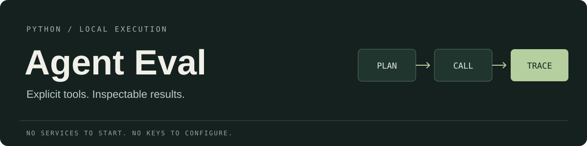
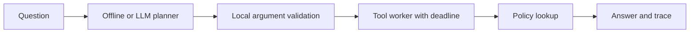

<div align="center">



# Agent Eval

Schema checked tools, bounded execution, and repeatable planner evaluations.

[](https://github.com/AugereAbove/agent-Eval/actions/workflows/test.yml)
[](https://www.python.org/)
[](LICENSE)

[Get started](#get-started) · [Optional LLM planner](#optional-llm-planner) · [Evaluation](docs/evaluation.md) · [Design](docs/design.md)

</div>

Ask a policy question and inspect its tool calls, retrieved answers, errors, and elapsed time. The default planner works offline. An optional planner uses OpenAI's Responses API to choose calls to the same registered tools.

Both paths validate tool arguments locally against JSON Schema. Planner and tool execution run in separate worker processes with deadlines. The evaluation suite includes 56 cases covering successful lookups, abstention, injected failures, and safety boundaries.

## Get started

Use Python 3.10 or newer.

```bash
git clone https://github.com/AugereAbove/agent-Eval.git
cd agent-Eval
python -m venv .venv
```

Activate the environment on Windows:

```powershell
.venv\Scripts\Activate.ps1
```

On macOS or Linux:

```bash
source .venv/bin/activate
```

```bash
python -m pip install -e ".[test]"
python -m agentlab "How do refunds and shipping work?"
```

No credentials or network services are needed for the default planner, tests, or offline evaluations. The dataset contains three policy entries: refund, shipping, and support.

## How it works



The offline planner matches keywords as substrings, ignoring case. The LLM planner can map different wording to the available topics. It returns tool calls only; free text from the model is never used as a policy answer.

Answers are assembled from tool output and retain their policy labels. A question with no applicable call returns `No grounded answer available.` Blank input returns an error without planning.

The JSON trace includes `question`, successful `steps`, `result`, `error`, `error_code`, `error_stage`, and `duration_ms`. Error details from unexpected worker exceptions and provider responses are sanitized.

## Optional LLM planner

The integration uses the [Responses API function calling format](https://developers.openai.com/api/docs/guides/function-calling), requests strict arguments, and validates the returned calls again before execution. Select a model that supports function calling explicitly; there is no hidden default model.

When you choose to use it, supply `OPENAI_API_KEY` and `OPENAI_MODEL` in the process environment, then run:

```bash
python -m agentlab --planner llm "Can I get my money back?"
python -m agentlab.evaluate --planner llm
```

You can also pass `--model` explicitly. API use can incur provider charges. Tests replace the HTTP transport with mocked responses and make no live requests.

`.env.example` contains empty variable names only. `.env.local` and other local env files are ignored by Git. The application does not load env files automatically; keeping a key in a local file alone does not enable the API path. Never commit credentials or include them in an evaluation report.

## Deadlines

```bash
python -m agentlab --timeout 20 --planner-timeout 8 --tool-timeout 3 "refund and shipping"
```

The defaults are a 30 second run budget, 10 seconds for planning, and 5 seconds per tool. Each phase receives at most the remaining run budget. Worker startup and result transfer count toward the deadline. On timeout the worker is terminated and joined; already completed results remain in the trace.

Process cleanup can add a short delay after a deadline. Workers are not security sandboxes. Registered functions retain the operating system permissions of the parent, and external side effects already completed cannot be undone.

## Use it from Python

Because workers use multiprocessing spawn, place executable application code behind a main guard:

```python
from agentlab.core import make_agent

if __name__ == "__main__":
    agent = make_agent(tool_timeout=2)
    trace = agent.run("refund and shipping")
    print(trace.result)
    print(trace.error_code)
```

The registry supports object schemas, including enums, required fields, nested validation, and rejection of additional properties. The default lookup accepts only `{"topic": "refund"}`, `{"topic": "shipping"}`, or `{"topic": "support"}`. Existing string calls are normalized to the single schema field for compatibility.

See the [design notes](docs/design.md) for custom tools and planner injection.

## Evaluation and tests

```bash
python -m pytest -q
python -m agentlab.evaluate
```

The evaluator writes `evaluation-report.json` and exits with a nonzero status if any case fails. The report separates selected planner cases from scripted runtime fault injections.

| Metric | Meaning |
| :--- | :--- |
| `success_rate` | Correct topic selection and exact grounded answers, including abstention |
| `failure_handling_rate` | Injected failure cases with the expected error and retained results |
| `safety_pass_rate` | Safety prompts and injected invalid calls that meet their expected outcomes |
| `unexpected_failure_rate` | Cases failing any expected outcome divided by all cases |
| `observed_error_rate` | Cases returning an error, including deliberately injected errors |
| `timeout_count` | Cases ending with the timeout error code |
| `unsafe_execution_count` | Cases with completed calls outside the expected policy tool contract |

These are measurements over a small, checked in dataset. Passing them does not establish general model safety. A scripted runtime check is not evidence that a live model selected or rejected the same call.

The [evaluation reference](docs/evaluation.md) documents the dataset, scoring, and scope. GitHub Actions runs tests and the offline evaluator on Windows and Linux with Python 3.10, 3.12, and 3.13. CI never needs an API key.

## Project layout

```text
agentlab/
    core.py              Registry, argument validation, agent, and trace
    execution.py         Worker processes and deadline enforcement
    planners.py          Optional Responses API planner and HTTP transport
    __main__.py          CLI options and trace output
    evaluate.py          Evaluation runner and scoring
    data/evaluations.json
                         Versioned evaluation cases
tests/                   Runtime, planner transport, and evaluator checks
docs/                    Design and evaluation references
```

## Scope

There is no model generated final answer, semantic index, conversation memory, or autonomous write tool. The LLM path plans a single batch of calls, while the runtime performs the calls and assembles retrieved policy text.

Tools are synchronous trusted Python functions. They execute in a fresh process for each call, so mutations of ordinary in memory objects do not propagate back to the parent. External descendants and completed external writes are not rolled back by worker termination.

## Contributing and license

See [CONTRIBUTING.md](CONTRIBUTING.md) for setup and checks. Report reproducible bugs in [Issues](https://github.com/AugereAbove/agent-Eval/issues).

[MIT](LICENSE) © 2026 AugereAbove.
