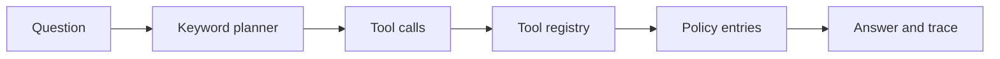

<div align="center">


# Agent Eval

A small, inspectable runtime for tool calls and repeatable evaluations.

[](https://github.com/AugereAbove/agent-Eval/actions/workflows/test.yml)
[](https://www.python.org/)
[](LICENSE)

[Get started](#get-started) · [How it works](#how-it-works) · [Technical details](docs/design.md) · [Contributing](CONTRIBUTING.md)

</div>

Ask a policy question and follow it through planning, tool execution, and a structured trace. The dataset is deliberately small: refunds, shipping, and support. Everything runs locally, with no API keys or network calls.

The planner uses keyword matching. The project focuses on the execution machinery around an agent: which tools can run, how calls are recorded, when execution stops, and how to check the results.

## Get started

Use Python 3.10 or newer.

```bash
git clone https://github.com/AugereAbove/agent-Eval.git
cd agent-Eval
python -m venv .venv
```

Activate the environment on Windows:

```powershell
.venv\Scripts\Activate.ps1
```

On macOS or Linux:

```bash
source .venv/bin/activate
```

Install the package and test dependency, then ask a question:

```bash
python -m pip install -e ".[test]"
python -m agentlab "How do refunds and shipping work?"
```

<details>
<summary>Example response</summary>

```json
{
  "question": "How do refunds and shipping work?",
  "steps": [
    {
      "tool": "knowledge_lookup",
      "input": "refund",
      "output": "Refunds are possible within 30 days with a receipt."
    },
    {
      "tool": "knowledge_lookup",
      "input": "shipping",
      "output": "Standard orders ship within three business days."
    }
  ],
  "result": "[refund] Refunds are possible within 30 days with a receipt.\n[shipping] Standard orders ship within three business days.",
  "error": null
}
```

</details>

Running `python -m agentlab` without a question uses the refund policy question.

## How it works



| Component | Responsibility |
| :--- | :--- |
| `DeterministicPlanner` | Match policy keywords and request up to three lookups |
| `ToolRegistry` | Register tools, reject unknown names, enforce the argument length limit |
| `Agent` | Run the plan up to its call limit and keep completed results |
| `Trace` | Carry the original query, successful calls, answer, and execution error |
| `evaluate()` | Check fixed questions against expected output and tool counts |

Matching ignores case and uses substrings. Answers follow the order of the policy dataset, regardless of the word order in the question. Each answer is labeled with the entry it came from.

## Use it from Python

```python
from agentlab.core import make_agent

agent = make_agent()
agent.max_steps = 1
trace = agent.run("refund and shipping")

print(trace.result)
print(trace.steps)
```

Tools receive a string and return a string. Registration and extension examples are in the [technical notes](docs/design.md#adding-a-tool).

## Tests and evaluation

```bash
python -m pytest -q
python -m agentlab.evaluate
```

The tests cover exact traces, missing answers, blank input, duplicate tool registration, unknown tools, argument boundaries, call limits, and partial results after a tool failure.

The evaluator writes `evaluation-report.json` in the current directory and prints the same report. Its four cases check answer fragments, minimum tool counts, and the absence of execution errors. The report is generated locally and excluded from Git.

GitHub Actions runs the suite on Windows and Linux with Python 3.10, 3.12, and 3.13.

## Behavior and limits

| Situation | Result |
| :--- | :--- |
| Matching policy keyword | Labeled policy text and a completed tool call |
| No matching keyword | `No grounded answer available.` |
| Blank query through the Python API | `empty query`, with no calls |
| Unregistered tool | `tool not allowed: <name>` |
| Argument above 1,000 characters | `argument is too long` |
| Tool raises `ValueError` | Stop, record the error, keep earlier answers |

The registry is an allowlist, not a sandbox. Registered Python functions run with the process's permissions. The call limit does not impose a timeout. Other exceptions propagate to the caller. Supply a nonnegative integer for `max_steps`; the runtime currently applies ordinary Python slicing without validating it.

There is no language model, semantic retrieval, conversation memory, or production service here. The evaluation measures this fixed dataset and planner, not general reasoning or model quality.

## Project layout

```text
agentlab/
    core.py          Runtime, policy entries, and tool registration
    __main__.py      Command line JSON output
    evaluate.py      Fixed evaluation cases and report output
tests/
    test_agent.py    Runtime and evaluation checks
docs/
    design.md        Execution details and extension examples
    banner.svg       Repository header
.github/
    workflows/       CI configuration
    ISSUE_TEMPLATE/  Bug reports and feature requests
```

## Contributing

See [CONTRIBUTING.md](CONTRIBUTING.md) for setup, checks, and what to include in a change. Bugs and feature requests belong in [Issues](https://github.com/AugereAbove/agent-Eval/issues).

## License

[MIT](LICENSE) © 2026 AugereAbove.
